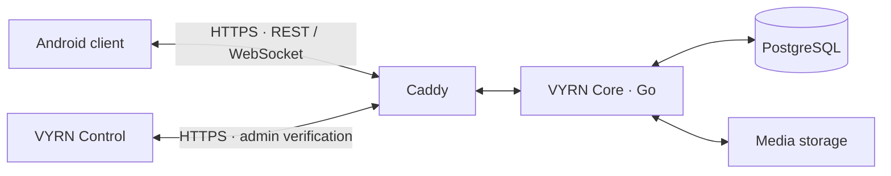

<!-- Keep the front page short; operational details live in docs/. -->
<p align="center">
  
</p>
<h1 align="center">VYRN</h1>
<p align="center"><strong>Your server. Your messaging network.</strong><br>پیام‌رسان مستقل، روی سرور خودتان.</p>
<p align="center">
  <a href="https://github.com/EclipseOfficialDota/VYRN/actions/workflows/ci.yml"></a>
  · Android 8+ · Go · PostgreSQL · Docker Compose · فارسی / English
</p>

**VYRN brings a Telegram-derived Android client, an independent messaging backend and a bilingual admin panel into one self-hosted project.** Accounts belong to your instance; they do not connect to Telegram or other VYRN servers.

[**Deploy your server →**](docs/DEPLOYMENT.md) · [**راهنمای فارسی →**](docs/OWNER_GUIDE.fa.md) · [**گزارش کار پروژه →**](docs/PROJECT_REPORT.fa.md) · [**Résumé summary →**](docs/PORTFOLIO.md)

> **Development preview — no supported Stable Android Release yet.** The older Debug prerelease is a test snapshot. Final signing, Release runtime acceptance and several lifecycle/security/operation gates remain open.

## What you get

| For users | For instance owners |
| --- | --- |
| Invite-based email/password accounts and recovery codes | Limited-use invitations and user blocking |
| Private and group messaging, edits, deletion and reactions | English/Persian Control with Authenticator verification |
| Read receipts, local search and durable offline queues | Password resets, session revocation and audit events |
| File, photo and voice-message paths | Docker deployment, HTTPS and S3-compatible encrypted backup tools |
| Encrypted local private drafts and Signal private-message integration | Your domain, database and media storage |

These are implemented paths with targeted tests, not complete Telegram feature parity. Voice/video **calls**, bots, stories and channels are unavailable. [Feature status](docs/ACCEPTANCE.md) · [Test evidence](docs/TEST_REPORT.md)

## How it works



The adapter connects Telegram's UI to VYRN's API. Core checks access and streams changes; SQLite preserves pending messages and Signal supports private-message encryption. [Architecture](docs/ARCHITECTURE.md) · [گزارش فارسی](docs/PROJECT_REPORT.fa.md)

## Self-host in five steps

Start with Ubuntu24.04, your domain and Docker Compose. A small evaluation budget is4GiB RAM, two cores and40GiB disk plus media/backup space; capacity is workload-dependent.

1. **Get the source:** `git clone https://github.com/EclipseOfficialDota/VYRN.git`
2. **Configure:** DNS, `VYRN_DOMAIN`, protected runtime secrets and your allowed admin IP/VPN.
3. **Launch:** build Core, start PostgreSQL, bootstrap the first administrator, then start Core/Caddy.
4. **Invite:** sign in to `https://admin.YOUR_SERVICE_DOMAIN` with email/password and Authenticator; create a limited-use invitation.
5. **Distribute:** build for your HTTPS API; supply the signed APK and corresponding source.

**[Copy the full server setup commands →](docs/DEPLOYMENT.md)** · **[مراحل نصب و ساخت کاربر به فارسی →](docs/OWNER_GUIDE.fa.md)**

The project APK targets the project's server; self-hosting requires a custom build. Install the [Windows/PowerShell7 prerequisites](docs/ANDROID_TESTING.md), then:

```powershell
./scripts/build-android.ps1 -Flavor dev -BuildType debug -ApiUrl https://api.vyrn.example.com
./scripts/verify-apks.ps1
```

Replace the example domain. Outputs: ARM64, ARMv7 and Universal, Android8+. [Final signing — keys stay outside Git/VPS](docs/RELEASE_SIGNING.md).

## From invitation to conversation

- **Owner:** create an invitation in Control → share it privately with the matching APK.
- **User:** register with email, password, display name and invitation → save the recovery code → sign in with email/password.
- **Then:** find participants using supported app controls and start a group or private conversation. Accounts and invitations stay local to that server.

Control manages access, not private plaintext. Group data/metadata have different privacy properties. Arrange tested offsite backups before relying on the instance.

<details>
<summary><strong>Explore the project — setup, engineering and portfolio</strong></summary>

| Guide | What is inside |
| --- | --- |
| [Self-hosting](docs/DEPLOYMENT.md) / [فارسی](docs/OWNER_GUIDE.fa.md) | Server setup, TLS, first admin, invitations and maintenance |
| [Project report — فارسی](docs/PROJECT_REPORT.fa.md) | What the app does and how its parts work |
| [Architecture](docs/ARCHITECTURE.md) / [API](docs/API.md) | Android adapter, service boundaries, requests and storage |
| [Android development](docs/ANDROID_TESTING.md) / [Signing](docs/RELEASE_SIGNING.md) | Reproducible build, focused testing and release identity |
| [Status](docs/ACCEPTANCE.md) / [Tests](docs/TEST_REPORT.md) | Supported paths, actual evidence and remaining gates |
| [Backup and restore](docs/BACKUP_RESTORE.md) / [Updates](docs/UPDATE_PROCESS.md) | Encrypted backups, isolated restore and update tooling |
| [Security](SECURITY.md) / [Design](docs/SECURITY.md) | Private vulnerability reporting and trust limits |
| [Résumé text](docs/PORTFOLIO.md) / [Contributing](CONTRIBUTING.md) | English/Persian project profile and contribution checks |

`android/` client and adapter · `backend/` API and migrations · `admin/` Control · `deployment/` service templates · `scripts/` build/test/operation tools. Credentials, generated upstream sources, SDKs, APKs and backups are excluded from Git.

</details>

## Attribution

Android UI derives from [DrKLO/Telegram](https://github.com/DrKLO/Telegram); VYRN is unaffiliated and adds its backend, adapter, branding and operation tooling. [License](LICENSE) · [Notices](NOTICE.md) · [Android terms](android/NOTICE.md) · [Corresponding-source obligations](docs/GPL_COMPLIANCE.md).
