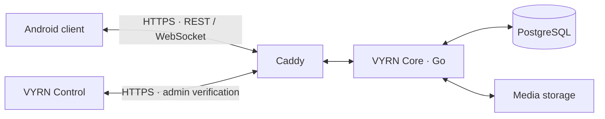

<div align="center">


# VYRN

[](README.md)
[](docs/README.fa.md)

**English documentation** · Click **فارسی** above to switch languages.

### Your server. Your people. Your messaging network.

[](docs/ANDROID_TESTING.md)
[](backend/go.mod)
[](docs/DEPLOYMENT.md)
[](docs/ACCEPTANCE.md)
[](https://github.com/EclipseOfficialDota/VYRN/actions/workflows/ci.yml)

**Independent messaging with a Telegram-derived Android client, a Go/PostgreSQL backend,
Signal private-message integration and an English/Persian administration panel.**

[راهنمای فارسی](docs/README.fa.md) · [Guided setup](docs/SETUP_WIZARD.md) · [Server installation](docs/DEPLOYMENT.md) ·
[Project report — فارسی](docs/PROJECT_REPORT.fa.md) · [Feature status](docs/ACCEPTANCE.md) ·
[Portfolio](docs/PORTFOLIO.md)

</div>

<p align="center">
  
  
</p>

Recorded development screenshots: Android sign-in and Persian Control. They are not
screenshots of a final Release. **VYRN is a development preview; no supported Stable
Android Release is available yet.** The existing Debug prerelease is an older snapshot.

## Deploy your own server

Start with a dedicated Ubuntu24.04 host, a domain and Git. The bilingual wizard can install Docker Compose. A small evaluation
budget is4GiB RAM, two cores and40GiB disk plus media/backup space; actual capacity depends on workload.

```sh
git clone https://github.com/EclipseOfficialDota/VYRN.git && cd VYRN && sudo bash setup.sh
```

Choose English or فارسی, then **Install / resume setup**. The wizard asks for your domain,
public IPv4, admin IP/VPN and first administrator credentials. It can create missing
Cloudflare DNS records using a hidden, unsaved token, or guide manual DNS configuration.
It generates protected settings, builds Core, bootstraps an empty database and checks HTTPS.

Reopen with `sudo bash setup.sh` to check status/HTTPS, enroll your authenticator or
start/stop the instance without deleting data. [Wizard guide](docs/SETUP_WIZARD.md) ·
[Manual setup, existing proxies and upgrades](docs/DEPLOYMENT.md).

Each installation has its own accounts. VYRN does not connect to Telegram or federate
with other VYRN servers.

```text
VYRN SETUP
1  Install / resume     2  Service status
3  Check HTTPS          4  Authenticator setup
5  Start services       6  Stop services (keep data)
7  Client instructions  0  Exit
```

Android compilation/signing stays on your Windows workstation; the wizard prints your
instance's build command. It does not change SSH/firewall policy or replace an existing proxy.

## Invite your first user

1. Open `https://admin.YOUR_SERVICE_DOMAIN`.
2. Sign in with your bootstrap email/password and current Authenticator code.
3. Create a limited-use, expiring invitation in **Control → Invites**.
4. Privately share the invitation and matching client APK. The person registers with
   email, password, display name and invitation, then saves the recovery code.

Later sign-in uses email/password. There is no shared administrator password.
[Owner and user guide — فارسی](docs/OWNER_GUIDE.fa.md)

## Build your Android client

Build on Windows with PowerShell7, JDK21 and the pinned Android SDK/NDK.
Install the [build prerequisites](docs/ANDROID_TESTING.md), then:

```powershell
./scripts/build-android.ps1 -Flavor dev -BuildType debug -ApiUrl https://api.vyrn.example.com
./scripts/verify-apks.ps1
```

Replace the example API hostname with yours. Outputs include ARM64, ARMv7 and Universal
APKs for Android8/API26+. The project's existing APK targets the project's server;
there is no login server switcher. Final keystores stay outside Git and the VPS.
[Production signing](docs/RELEASE_SIGNING.md) · [Source redistribution](docs/GPL_COMPLIANCE.md)

## The messaging experience

| Area | Implemented paths |
| --- | --- |
| Accounts | Invite registration, email/password login, recovery codes and device sessions |
| Conversations | Private/group messages, history, edits, deletion, reactions and read receipts |
| Connectivity | Durable local queues, reconnect handling, local search and protected private drafts |
| Media | File, photo and voice-message paths with size/quota checks |
| Control | Persian/English UI, TOTP, invitations, blocking, password resets, session revocation and audit |
| Operations | Container deployment, HTTPS, health checks and encrypted S3-compatible backup tooling |

These paths have targeted tests, not complete Telegram feature parity or production acceptance.
Voice/video **calls**, bots, stories and channels are unavailable. Voice messages are separate from calls.

## How messages move



The adapter connects Telegram's UI to VYRN's API. Core checks access, stores authorized
changes and streams events. SQLite preserves pending messages; Signal supports implemented
private-message encryption paths. Group data and metadata have different privacy properties.

Control manages access, not private plaintext. Full lifecycle/background coverage and
independent security review remain unfinished. [Architecture](docs/ARCHITECTURE.md) ·
[Security](docs/SECURITY.md) · [گزارش کامل نحوهٔ کار](docs/PROJECT_REPORT.fa.md)

## Validation and release status

The2026-10-20 critical Android record contains438 passing checks across authentication,
outbox integration/migrations, Signal networking and sessions. These are recorded assertions,
not438 independent user journeys. Fresh two-client retesting stopped on host emulator crashes.

Final signing, optimized Release runtime acceptance, physical-device coverage and other
[release gates](docs/ACCEPTANCE.md) remain open. Configure and rehearse offsite backup
for your own installation; same-server snapshots are temporary.

## Documentation and development

| Guide | Contents |
| --- | --- |
| [Setup wizard](docs/SETUP_WIZARD.md) | Beginner-friendly terminal setup and service controls |
| [فارسی](docs/README.fa.md) / [Owner guide](docs/OWNER_GUIDE.fa.md) | معرفی، نصب، دعوت کاربر و مدیریت روزمره |
| [Server setup](docs/DEPLOYMENT.md) | DNS, Docker, first administrator, TLS and upgrades |
| [Project report](docs/PROJECT_REPORT.fa.md) | نحوهٔ عملکرد اپ، امکانات و کارهای باقی‌مانده |
| [Android](docs/ANDROID_TESTING.md) / [Signing](docs/RELEASE_SIGNING.md) | Client builds, focused tests and release keys |
| [Architecture](docs/ARCHITECTURE.md) / [API](docs/API.md) | Adapter, service boundaries, data and requests |
| [Backups](docs/BACKUP_RESTORE.md) / [Updates](docs/UPDATE_PROCESS.md) | Encrypted recovery and update tooling |
| [Status](docs/ACCEPTANCE.md) / [Validation](docs/TEST_REPORT.md) | Supported paths, evidence and known gaps |
| [Security](SECURITY.md) / [Contributing](CONTRIBUTING.md) | Private reporting and development checks |
| [Portfolio summary](docs/PORTFOLIO.md) | English/Persian résumé introduction |

`android/` client · `backend/` API · `admin/` Control · `deployment/` service templates ·
`scripts/` tooling. Generated upstream sources, SDKs, APKs, credentials and backups stay out of Git.

VYRN is independent of Telegram. Its Android UI derives from
[DrKLO/Telegram](https://github.com/DrKLO/Telegram); VYRN adds the backend, adapter,
branding and operation tooling. Preserve [licenses](LICENSE), [notices](NOTICE.md),
[Android terms](android/NOTICE.md) and [corresponding-source obligations](docs/GPL_COMPLIANCE.md).
