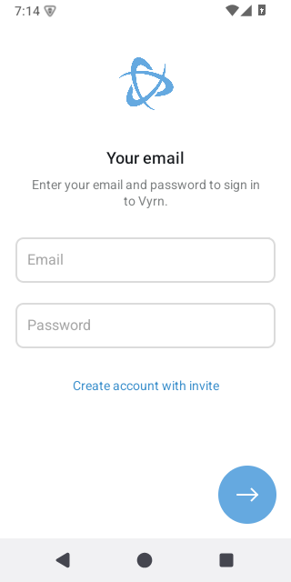
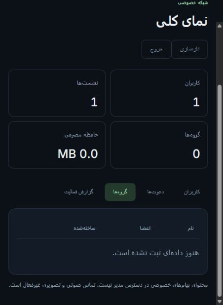

<div align="center">


# VYRN

[](../README.md)
[](README.fa.md)

**مستندات فارسی** · برای تغییر زبان، روی **English** بزنید.

### سرور خودتان. آدم‌های خودتان. شبکهٔ پیام‌رسان خودتان.

[](ANDROID_TESTING.md)
[](../backend/go.mod)
[](DEPLOYMENT.md)
[](ACCEPTANCE.md)
[](https://github.com/EclipseOfficialDota/VYRN/actions/workflows/ci.yml)

**پیام‌رسان مستقل با کلاینت اندروید مشتق‌شده از تلگرام، Backend اختصاصی Go/PostgreSQL،
یکپارچه‌سازی پیام خصوصی با Signal و پنل مدیریت فارسی/انگلیسی.**

[راه‌انداز تعاملی](SETUP_WIZARD.md) · [نصب دستی](DEPLOYMENT.md) · [راهنمای مدیر و کاربر](OWNER_GUIDE.fa.md) ·
[گزارش کار](PROJECT_REPORT.fa.md) · [وضعیت امکانات](ACCEPTANCE.md) · [معرفی رزومه](PORTFOLIO.md)

</div>

<p align="center">
  
  
</p>

تصاویر واقعی ثبت‌شده از نسخهٔ توسعه هستند؛ تصویر Release نهایی نیستند.
**پروژه فعلاً Development Preview است و نسخهٔ Stable پشتیبانی‌شده ندارد.**
نسخهٔ Debug موجود در Releases، خروجی آزمایشی قدیمی‌تر است.

## نصب روی سرور خودتان

برای آزمایش کوچک، Ubuntu24.04، دامنهٔ شخصی و Git آماده کنید؛ راه‌انداز می‌تواند Docker را نصب کند.
بودجهٔ اولیه:۴ گیگابایت رم،۲ هسته و۴۰ گیگابایت دیسک، به‌علاوهٔ فضای رسانه و بکاپ.
این عددها تضمین ظرفیت نیستند.

```sh
git clone https://github.com/EclipseOfficialDota/VYRN.git && cd VYRN && sudo bash setup.sh --lang fa
```

گزینهٔ۱ را انتخاب کنید. پنل، دامنه، IPv4 عمومی و IP مدیر را می‌پرسد؛ تنظیمات محرمانه را
می‌سازد، Core و دیتابیس را راه می‌اندازد، مدیر اولیه را فقط در دیتابیس خالی می‌سازد و
HTTPS را بررسی می‌کند. DNS اختیاری Cloudflare با توکن مخفی و بدون ذخیره‌کردن آن انجام
می‌شود؛ برای Provider دیگر، رکوردها را نشان می‌دهد و بررسی می‌کند.

با اجرای دوبارهٔ `sudo bash setup.sh --lang fa`، وضعیت و HTTPS را ببینید، Authenticator
را تنظیم کنید یا سرویس‌ها را بدون حذف داده روشن/متوقف کنید.
[راهنمای راه‌انداز](SETUP_WIZARD.md) · [نصب دستی و پراکسی موجود](DEPLOYMENT.md)

ساخت و امضای اپ روی کامپیوتر ویندوز باقی می‌ماند؛ پنل دستور مخصوص API شما را می‌دهد.
SSH، فایروال و پراکسی فعلی خودکار تغییر نمی‌کنند.

هر نصب حساب‌های خودش را دارد. حساب تلگرام وارد این شبکه نمی‌شود و نصب‌های مختلف VYRN
هم به یکدیگر متصل نیستند. [آموزش فارسی عملیات](OWNER_GUIDE.fa.md)

## اولین کاربر را دعوت کنید

۱. آدرس `https://admin.YOUR_SERVICE_DOMAIN` را باز کنید.

۲. با ایمیل و رمز مدیر اولیه وارد شوید و کد فعلی شش‌رقمی Authenticator را بدهید.

۳. در بخش «دعوت‌ها»، یک کد با تعداد استفاده و مدت اعتبار محدود بسازید.

۴. کد و APK مربوط به همان سرور را خصوصی به فرد بدهید؛ فرد با ایمیل، رمز، نام نمایشی
و دعوت ثبت‌نام می‌کند و کد بازیابی را امن نگه می‌دارد.

ورود بعدی با ایمیل و رمز است. رمز عمومی یا پیش‌فرض برای مدیر وجود ندارد.

## اپ مخصوص سرور خودتان را بسازید

روی ویندوز، PowerShell7 و JDK21 و Android SDK/NDK مشخص‌شده را آماده کنید.
پس از [نصب پیش‌نیازها](ANDROID_TESTING.md):

```powershell
./scripts/build-android.ps1 -Flavor dev -BuildType debug -ApiUrl https://api.vyrn.example.com
./scripts/verify-apks.ps1
```

دامنهٔ نمونه را با API خودتان عوض کنید. خروجی‌های ARM64، ARMv7 و Universal برای
Android8 به بالا ساخته می‌شوند. APK آمادهٔ پروژه به سرور پروژه وصل می‌شود؛ در ورود،
گزینهٔ تعویض سرور نداریم. کلید نهایی امضا را داخل Git یا VPS قرار ندهید.
[امضای نهایی](RELEASE_SIGNING.md) · [الزامات انتشار سورس](GPL_COMPLIANCE.md)

## امکانات

| بخش | مسیرهای پیاده‌سازی‌شده |
| --- | --- |
| حساب | ثبت‌نام دعوتی، ورود ایمیلی، بازیابی و نشست دستگاه |
| گفتگو | پیام خصوصی/گروهی، تاریخچه، ویرایش، حذف، واکنش و رسید خواندن |
| اتصال | صف محلی پایدار، تلاش مجدد، جست‌وجو و پیش‌نویس خصوصی محافظت‌شده |
| رسانه | مسیرهای فایل، عکس و پیام صوتی با محدودیت اندازه و فضا |
| مدیریت | پنل دوزبانه، Authenticator، دعوت، مسدودسازی، تغییر رمز، لغو نشست و گزارش فعالیت |
| عملیات | Docker، HTTPS، سلامت سرویس و ابزار بکاپ رمزگذاری‌شدهٔ S3-compatible |

این امکانات تست‌های هدفمند دارند؛ همهٔ صفحه‌ها و شرایط پذیرش کامل ندارند.
تماس صوتی/تصویری، بات، استوری و کانال فعلاً در دسترس نیستند. پیام صوتی با تماس فرق دارد.

## اپ چطور کار می‌کند؟

رابط تلگرام از طریق لایهٔ اتصال VYRN به API مستقل وصل می‌شود. Core هویت و مجوز را
بررسی می‌کند، دادهٔ مجاز را ثبت می‌کند و تغییرات را از مسیر رویدادها می‌فرستد.
صف SQLite پیام‌های منتظر را نگه می‌دارد؛ مسیر خصوصی با Signal یکپارچه شده است.

پنل ابزار خواندن متن خصوصی نیست. پیام گروهی و اطلاعات جانبی، حریم خصوصی یکسانی
با پیام خصوصی ندارند. بررسی امنیتی مستقل و پذیرش کامل چرخهٔ حساب/رسانه/پس‌زمینه
هنوز باقی است. [معماری و نمودار](../README.md#how-messages-move) · [گزارش کامل فارسی](PROJECT_REPORT.fa.md)

## تست و وضعیت انتشار

در رکورد ۲۰ اکتبر ۲۰۲۶، مجموع۴۳۸ بررسی در ورود، صف و مهاجرت داده، Signal و نشست‌ها
موفق بوده‌اند؛ این عدد۴۳۸ سفر مستقل کاربری نیست. دو تلاش تازهٔ دوکلاینتی با کرش
شبیه‌ساز میزبان متوقف شدند و موفق محسوب نشده‌اند.

امضای نهایی، تست خودِ Release بهینه‌شده، دستگاه فیزیکی و سایر
[معیارهای پذیرش](ACCEPTANCE.md) باقی مانده‌اند. بکاپ خارج از سرور و تمرین بازیابی
برای هر نصب لازم است؛ کپی روی همان VPS موقت است.

## راهنماها

| راهنما | محتوا |
| --- | --- |
| [راه‌انداز ترمینالی](SETUP_WIZARD.md) | نصب مرحله‌ای و کنترل سرویس‌ها برای مبتدیان |
| [نصب](DEPLOYMENT.md) / [مدیر و کاربران](OWNER_GUIDE.fa.md) | سرور، دامنه، HTTPS، ورود و دعوت |
| [گزارش کار](PROJECT_REPORT.fa.md) / [رزومه](PORTFOLIO.md) | عملکرد پروژه و معرفی فارسی/انگلیسی |
| [اندروید](ANDROID_TESTING.md) / [امضا](RELEASE_SIGNING.md) | ساخت، تست و کلید نهایی |
| [معماری](ARCHITECTURE.md) / [API](API.md) | ارتباط اجزا و درخواست‌ها |
| [بکاپ](BACKUP_RESTORE.md) / [به‌روزرسانی](UPDATE_PROCESS.md) | نگهداری و بازیابی |
| [تست‌ها](TEST_REPORT.md) / [وضعیت](ACCEPTANCE.md) | شواهد و محدودیت‌ها |
| [امنیت](../SECURITY.md) / [مشارکت](../CONTRIBUTING.md) | گزارش محرمانه و توسعه |

رابط اندروید از [DrKLO/Telegram](https://github.com/DrKLO/Telegram) مشتق شده است.
VYRN وابسته به تلگرام نیست؛ Backend، لایهٔ اتصال، برند و ابزارهای عملیاتی خودش را دارد.
[مجوزها](../LICENSE)، [اعلان‌ها](../NOTICE.md) و [الزامات سورس](GPL_COMPLIANCE.md) باید حفظ شوند.
